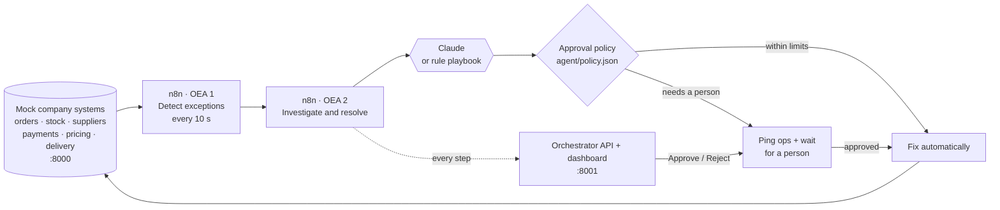

# OrderGuard AI

**When an order breaks, a person gets a decision, not an investigation.**

OrderGuard AI is an **n8n automation** for order exceptions. When stock, a supplier, a payment, a price or a delivery deadline goes wrong, it:

1. **detects** the broken order,
2. **investigates** the real cause across the order systems (with Claude, or rule playbooks when Claude is off),
3. **decides** with an approval policy whether the fix can run on its own,
4. **fixes it automatically**, or **asks a person** with ranked options, costs and evidence,
5. **records** every step in an audit trail. Any automatic fix can be undone in one click.

Built for a 30-hour hackathon by a team of four.

---

## How it works



| Part | Port | What it does |
|---|---|---|
| **n8n** | 5678 | Runs the process: two workflows, *OEA 1 · Detect exceptions* and *OEA 2 · Investigate and resolve* (37 nodes). Pauses on a **Wait** node until a person decides. |
| **Orchestrator** | 8001 | The API the dashboard uses, the `/n8n` bridge the workflows call, and the dashboard itself at `/ui`. |
| **Mock company systems** | 8000 | FastAPI apps for orders, inventory, suppliers, payments, pricing and delivery, sharing one SQLite database. Failure scenarios change their data. |
| **Dashboard** | served on 8001 | React app: overview, exceptions, investigation, approvals, workflow monitor, audit trail, suppliers. |

**Who decides what.** Claude only reads data and *proposes* fixes. Code re-checks every cost against live data. The policy file decides what may run alone. A person approves anything risky.

---

## Demo scenarios

Pick one from **Trigger a failure** in the dashboard.

| Scenario | Order | What the system does | Cost |
|---|---|---|---|
| Phantom stock | ORD-1001 | Shelf is empty although the system says 5. Ships from another warehouse **automatically** | ₹120 |
| Phantom stock with a tight deadline | ORD-1001 | Two problems at once. Moves the stock **and** upgrades shipping, **automatically** | ₹470 |
| Supplier misses ship date | ORD-1002 | Delivery 5.5 days late. Proposes a new supplier + express; **needs a person** | ₹2,350 |
| Payment declined — expired card | ORD-1003 | Emails the customer to update the card, **automatically**; no retry | ₹0 |
| Payment declined — fraud signals | ORD-1003 | Holds the order at once; **needs a person**; never retries | — |
| Discount stacking below margin | ORD-1004 | Holds the order; proposes a corrected price; **needs a person** | — |

Scenarios that share an order (ORD-1001, ORD-1003) need a **Reset demo** between them.

---

## Run it locally

### Prerequisites

| Tool | Version | Needed for |
|---|---|---|
| Python | 3.11 or newer | backend, mock systems, tests |
| Node.js + npm | 20, 22 or 24 | building the dashboard, running n8n |
| Git | any | cloning |

Check them:

```bash
python --version      # Windows: py -3 --version
node --version
npm --version
```

### 1. Clone

```bash
git clone https://github.com/<your-username>/<your-repo>.git
cd <your-repo>
```

### 2. Python environment and packages

**macOS / Linux**
```bash
python3 -m venv .venv
source .venv/bin/activate
pip install -r requirements.txt
```

**Windows (PowerShell)**
```powershell
py -3 -m venv .venv
.venv\Scripts\Activate.ps1          # in cmd.exe: .venv\Scripts\activate.bat
pip install -r requirements.txt
```

### 3. Build the dashboard (once, and after any UI change)

```bash
cd dashboard
npm install
npm run build
cd ..
```

This creates `dashboard/dist`, which the orchestrator serves at http://localhost:8001. It is not committed to Git, so a fresh clone needs this step.

### 4. Settings (optional)

```bash
cp .env.example .env                # Windows: copy .env.example .env
```

Everything works without changes. Fill in only what you want:

| Variable | Effect |
|---|---|
| `ANTHROPIC_API_KEY` | Claude does the investigation. Empty means the rule playbooks do it (same output, works offline). |
| `OEA_SLACK_WEBHOOK_URL` | Posts "needs a decision" pings to a Slack channel. |
| `OEA_ENGINE` | `n8n` (default) or `python` (built-in engine, no n8n). |
| `SUPABASE_PUBLISHABLE_KEY` | Dashboard sign-in with Supabase accounts. |
| `SUPABASE_SECRET_KEY` | Copies every case record to your Supabase project. Backend only; never commit it. |
| `SARVAM_API_KEY` | Optional upgrade for the voice assistant: English + Hindi through Sarvam AI. Without it, voice uses the browser (English, no key). |

Supabase setup (run the SQL, keys, creating accounts): [`supabase/README.md`](supabase/README.md).

### 5. Start everything

```bash
python scripts/dev.py               # Windows: py -3 scripts\dev.py
```

This one command starts the mock systems, the orchestrator and n8n. It imports and switches on both workflows, then prints the dashboard and n8n addresses once everything answers. The **first run downloads n8n 1.123.85** through `npx`, which takes a few minutes. Press **Ctrl+C** to stop everything it started.

**On Windows**, after steps 1 and 3 you can instead double-click **`run-demo.bat`**. It installs the Python packages, starts everything and opens both pages in your browser.

### 6. Open it

| Page | URL |
|---|---|
| Dashboard | http://localhost:8001 |
| n8n editor | http://localhost:5678 |
| Mock systems API docs | http://localhost:8000/docs |
| Orchestrator API docs | http://localhost:8001/docs |

If Supabase sign-in is on, the dashboard first asks you to sign in with an account created in your Supabase project.

On your first visit to n8n, it asks you to **create an owner account**. This is a local login stored in `.n8n-data/`.

### 7. Try it

1. In the dashboard click **Trigger a failure** → **Phantom stock**. The case opens and is fixed automatically within seconds.
2. **Trigger a failure** → **Supplier misses ship date** → **Approvals** → **Approve**. The paused n8n run resumes and executes the fix.
3. Open an automatically fixed case and click **Undo this fix** to reverse it.
4. Watch the runs in n8n under **Executions**.
5. **Audit trail** → **Download PDF** → in the print window choose **Save as PDF**. The report has a summary, one section per case (cause, who decided, actions, money spent, full timeline) and the order systems' action log. It follows the page's filter.
6. **Reset demo** restores the clean starting state.

**Voice (Chrome or Edge, no key needed):** click **Ask** in the top bar and say "What needs my attention?". It answers out loud from the live case data, then asks a follow-up ("Would you like me to explain ORD-1002?") and listens for your reply: "yes", "why", "next one", "approve it" or "no thanks". You can also type. Voice can open a case for approval but never approves: you confirm on screen. The browser asks for microphone permission the first time, and speech recognition needs internet. With a working `SARVAM_API_KEY` it uses Sarvam instead (English + Hindi); check a key with `python scripts/check_sarvam.py` (never prints the key).

Or drive it from a terminal while the stack is running:

```bash
curl -X POST "http://localhost:8001/trigger?fail=sc5"     # sc1 | sc2 | sc3_expired | sc3_fraud | sc4 | sc5
curl http://localhost:8001/exceptions
curl -X POST http://localhost:8001/reset
python scripts/demo_scenario.py sc2 --approve              # narrated walkthrough of one scenario
```

On Windows PowerShell use `curl.exe` instead of `curl`.

---

## Other ways to run

**Without Node.js / n8n.** The same process runs in the built-in Python engine; the dashboard is identical, but there is no n8n editor. You still need Node once to build the dashboard (step 3).
```bash
python scripts/dev.py --python
```

**With an n8n you already run** (Docker, desktop, cloud): import `n8n/workflows/1-detect-exceptions.json` and `n8n/workflows/2-investigate-and-resolve.json` (**Workflows → Import from file**) and switch both on. Then start the backend pointed at it:
```bash
OEA_N8N_URL=http://localhost:5678 python scripts/dev.py
```
The environment variables n8n needs are listed in [`n8n/README.md`](n8n/README.md).

**Dashboard with hot reload** (for UI work), with the stack running in another terminal:
```bash
cd dashboard
npm run dev                         # http://localhost:5173
```

**Each part on its own** (for backend work):
```bash
python -m uvicorn services.app:app --port 8000 --reload
python -m uvicorn orchestrator.app:app --port 8001 --reload     # second terminal; Python engine
```

---

## Tests

```bash
python -m pytest services/tests agent/tests orchestrator/tests n8n/test_policy_parity.py -q
```

52 tests cover the mock systems, every scenario, the agent and its fallback, the orchestrator API, undo, Supabase sign-in and record copying (simulated), the voice assistant and its conversation (Sarvam simulated), the n8n bridge, and a check that n8n's policy node and the Python policy agree on 400 random cases.

End to end through real n8n (with `python scripts/dev.py` running in another terminal):

```bash
python n8n/e2e_check.py             # (with Supabase sign-in on, start with OEA_REQUIRE_LOGIN=0) all 6 scenarios + approve, reject and undo; prints ALL PASSED
```

---

## Project structure

```
├── n8n/                    the automation
│   ├── workflows/          the two workflow JSON files n8n imports
│   ├── build_workflows.py  generates the JSON (edit this, then: python n8n/build_workflows.py)
│   ├── policy_engine.js    the approval policy as it runs inside n8n
│   └── e2e_check.py        end-to-end check through real n8n
├── services/               mock company systems (:8000) and detector/ rules
├── agent/                  investigation (Claude + rule playbooks), policy engine, policy.json, undo
├── orchestrator/           dashboard API (:8001), the /n8n bridge, Supabase sign-in + record copy (auth_api.py), voice (voice_api.py)
├── supabase/               schema.sql to run in the Supabase SQL Editor, setup guide
├── dashboard/              React + Vite + Tailwind UI
├── data/                   database schema and deterministic seed (50 orders)
├── scripts/                dev.py (start everything), demo_scenario.py, wait_ready.py, check_sarvam.py
├── docs/                   architecture, decisions, demo script, requirements, progress
└── run-demo.bat            one-click start on Windows
```

The approval policy lives in **`agent/policy.json`**: edit it to change which fixes run on their own (cost limits, actions that always need a person, VIP and high-value rules).

---

## Troubleshooting

| Problem | Fix |
|---|---|
| http://localhost:8001 shows API docs, not the dashboard | The dashboard isn't built: run step 3, then restart. |
| `Node.js not found` | Install Node 20–24 from https://nodejs.org, or run `python scripts/dev.py --python`. |
| First start is slow | The first run downloads n8n. Later starts take seconds. |
| `Address already in use` on 8000, 8001 or 5678 | Another copy is running. Stop it with Ctrl+C, or find it: `lsof -i :8001` (macOS/Linux), `netstat -ano \| findstr :8001` (Windows). |
| PowerShell won't run `Activate.ps1` | Use cmd.exe and `.venv\Scripts\activate.bat`, or skip activation and call `.venv\Scripts\python` directly. |
| A case stays on "Investigating" | Click **Reset demo** and trigger again. Check the n8n **Executions** tab for the run. |
| Want a clean slate | Stop the stack, delete `data/oea.db` (and `.n8n-data/` to reset n8n), start again. |

---

## Documentation

| File | Contents |
|---|---|
| [`docs/ARCHITECTURE.md`](docs/ARCHITECTURE.md) | Components, APIs, data model, scenarios, policy |
| [`n8n/README.md`](n8n/README.md) | Every workflow node, settings, changing a workflow |
| [`BACKEND.md`](BACKEND.md) | Backend files and endpoints |
| [`docs/DECISIONS.md`](docs/DECISIONS.md) | Design decisions (ADR-001 to ADR-015) |
| [`docs/DEMO_SCRIPT.md`](docs/DEMO_SCRIPT.md) | The 5-minute demo, click by click, with judge Q&A |

## Team

| Role | Name |
|---|---|
| Backend and data | [Name] |
| Agent and policy | [Name] |
| Dashboard | [Name] |
| Automation, integration and demo | [Name] |
